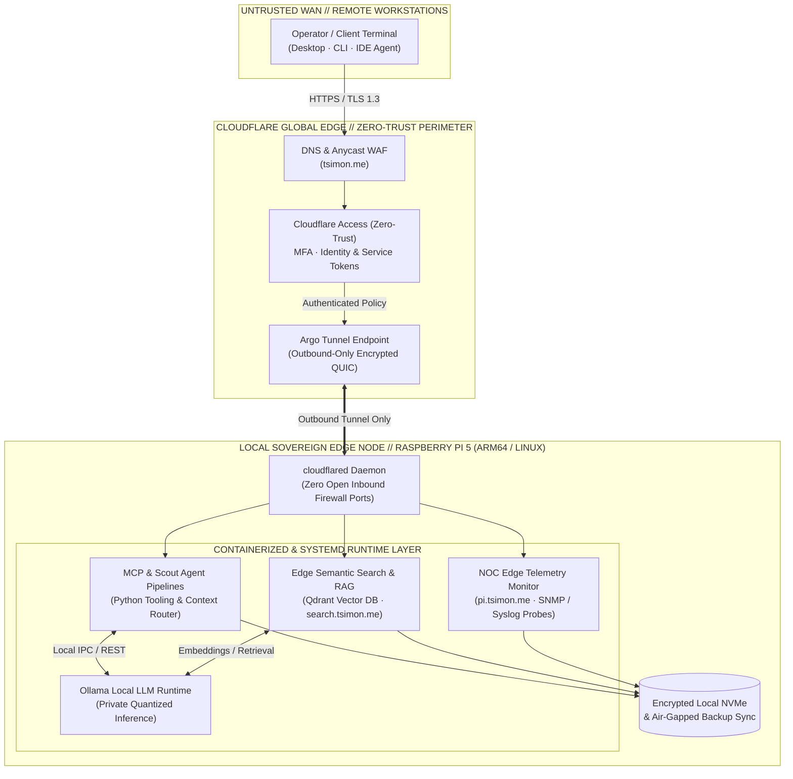

# THOMAS SIMON // SYSTEMS ARCHITECT · NOC ENGINEER · AI CONTEXT ENGINEER

> **Infrastructure Built on First Principles. Systems Engineered for Human Sovereignty.**

I design, stabilize, and document cloud infrastructure, virtualized networks, and human-aligned AI workflows. Combining 13+ years of production infrastructure operations across 100+ client environments with telecommunications engineering (CNAM France) and local Edge AI orchestration, I bridge the gap between complex machine topologies and the operators who rely on them.

[](https://tsimon.me)
[](https://minkalab.net)
[](https://pi.tsimon.me)
[](https://search.tsimon.me)
[](https://www.linkedin.com/in/tsimonfreelance/)

---

### `[01 // OPERATOR_SPEC.yaml]`

```yaml
OPERATOR_SPEC:
  identity: "Thomas Mathieu Simon"
  credentials: "AS Telecom & Computer Networks (CNAM France)"
  current_location: "La Paz, Bolivia [UTC-4]"
  languages: ["French (Native)", "English (Fluent)", "Spanish (Working)"]
  operational_posture: "Remote Synchronous (US EST/CST/PST · LATAM · EU Overlap)"
  machine_layer:
    - "Cloud & Hybrid Infrastructure (Azure, M365, BCDR)"
    - "Enterprise Virtualization (VMware ESXi, Hyper-V)"
    - "Deterministic IaC & Config Management (Terraform, Ansible, Linux)"
    - "High-Signal NOC Observability & SNMP Telemetry (3,500+ Endpoints)"
  operator_layer:
    - "AI Context Engineering & Multi-Agent Pipelines (RLHF Rubrics)"
    - "Local Edge Compute & RAG (Raspberry Pi 5, Ollama, Qdrant, Cloudflare Zero-Trust)"
    - "Model Context Protocol (MCP) Server & Tooling Integration"
    - "Civic Digital Sovereignty & Pedagogical Labs (Minka Lab)"
  status: "ONLINE // AVAILABLE_FOR_SELECT_CONTRACTING"
```

---

### `[02 // AUTONOMOUS EDGE AI & ZERO-TRUST TOPOLOGY]`

Self-hosted, air-tight cognitive and telemetry node running on ARM64 hardware (`Raspberry Pi 5`), exposing zero inbound WAN ports via **Cloudflare Zero-Trust Tunnels (`cloudflared`)** while serving local LLM inference (**Ollama**), vector RAG (**Qdrant**), **Model Context Protocol (MCP)** tool endpoints, and sovereign search.



---

### `[03 // CORE ARCHITECTURE & OPERATIONAL MATRIX]`

| Domain | Operational Scope & Production Outcomes | Primary Stack |
| :--- | :--- | :--- |
| **01 / Enterprise NOC & Fleet Observability** | Managed **100+ client tenants** and **3,500+ endpoints**. Tuned SNMP/Syslog baselines and codified deterministic runbooks to achieve a **40% reduction in MTTR** and **99.9%+ SLA** stability. | `Azure` `VMware ESXi` `Hyper-V` `SNMP` `PowerShell` `RMM` `BCDR` |
| **02 / Edge Compute, Local RAG & AI Agents** | Engineered private local inference nodes, vector RAG hubs, and **multi-agent reconnaissance pipelines** eliminating third-party telemetry leakage and recurring cloud API overhead. | `Raspberry Pi 5` `Ollama` `Qdrant` `MCP` `Python` `Cloudflare Tunnels` |
| **03 / Security, Hygiene & Zero-Trust** | Pragmatic endpoint hardening, Zero-Trust perimeter segmentation, automated DNS/HTTP security auditing, and air-gapped BCDR pipelines. | `Zero-Trust` `WireGuard` `iptables` `GPG/PGP` `Ansible` `Terraform` |
| **04 / Civic Pedagogy & Sovereignty** | Founder of **[Minka Lab](https://minkalab.net)** in La Paz, Bolivia—delivering trilingual (EN/FR/ES) Linux, encryption, and AI literacy curricula for high-agency operators. | `Linux` `Open-Source Tooling` `Trilingual Docs` `Digital Hygiene` |

---

### `[04 // DEPLOYED SYSTEMS & REPOSITORY INDEX]`

#### `// 04.1 FLAGSHIP EDGE, ZERO-TRUST & AI REPOSITORIES`
* **[`raspberry-pi-cloudflare-network-operations-monitor`](https://github.com/t0m-a/raspberry-pi-cloudflare-network-operations-monitor)** — Autonomous ARM64 NOC telemetry and network operations monitor powering [`pi.tsimon.me`](https://pi.tsimon.me). Engineered for Raspberry Pi 5 with systemd service hardening and outbound-only Cloudflare Zero-Trust Tunnels (zero open inbound firewall ports).
* **[`Edge-Semantic-Search-RAG-Knowledge-Hub`](https://github.com/t0m-a/Edge-Semantic-Search-RAG-Knowledge-Hub)** — Sovereign, zero-telemetry semantic search and Retrieval-Augmented Generation (RAG) knowledge base backing [`search.tsimon.me`](https://search.tsimon.me). Combines local quantized embeddings, **Qdrant** vector storage, and **Ollama** inference on edge hardware.
* **[`scout-analyst-pipelines-agents`](https://github.com/t0m-a/scout-analyst-pipelines-agents)** — Multi-stage agentic reconnaissance, data extraction, and structured analytical synthesis pipelines in Python. Designed for deterministic context routing, automated triage, and high-signal reporting.

#### `// 04.2 CIVIC PEDAGOGY, OPERATOR RUNBOOKS & LEGACY ARCHIVE`
* **[`MinkaLab` (`minkalab.net`)](https://github.com/t0m-a/MinkaLab)** — Open-source educational platform and digital sovereignty curriculum engineered for Latin American learners.
* **[`Wiki` (Operator Runbooks & Hardening Matrices)](https://github.com/t0m-a/Wiki)** — Field-tested Linux server administration, `iptables` firewall architectures, Docker containerization, and system hardening notes.
* **Legacy Infrastructure Archive (2018–2019)** — Foundational configuration management and container builds retained for historical continuity, including [`Ansible`](https://github.com/t0m-a/Ansible) multi-tier playbooks, hardened [`nginx-vhosts`](https://github.com/t0m-a/nginx-vhosts) SSL/HSTS reverse-proxy templates, and [`docker-image-builds`](https://github.com/t0m-a/docker-image-builds) (**10,000+ pulls** on Docker Hub).

---

### `[05 // DIRECT INGESTION PATHWAYS]`

* **Technical Portfolio & Dossiers:** [https://tsimon.me](https://tsimon.me) *(Senior NOC Engineer & AI/Cloud Architect PDFs available on-site)*
* **Direct Electronic Mail:** [contact@tsimon.me](mailto:contact@tsimon.me) // [hello@tsimon.me](mailto:hello@tsimon.me)
* **PGP Public Key (`0xA1048A81B9AEA757`):** `BDFC AB33 0606 4875 55F0 C3C6 A104 8A81 B9AE A757`
